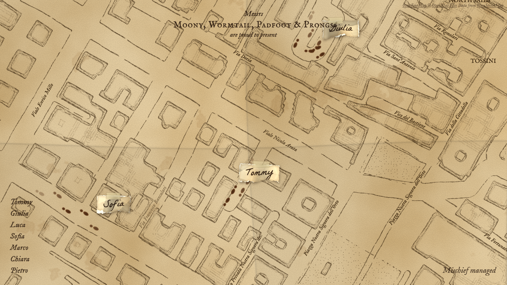
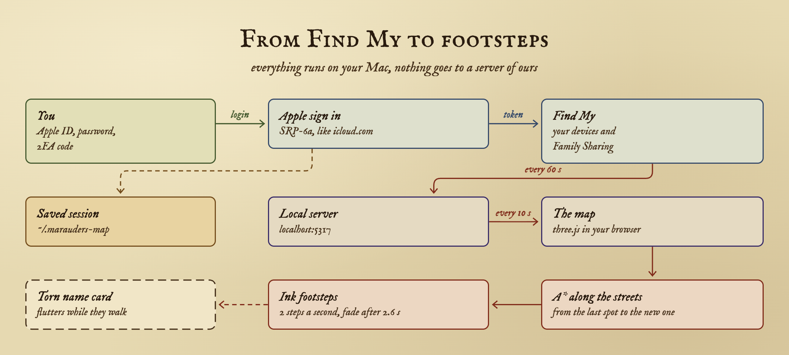
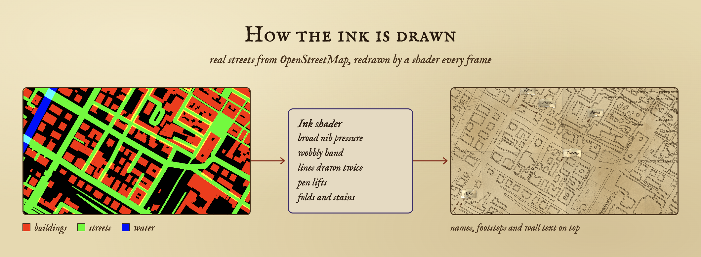
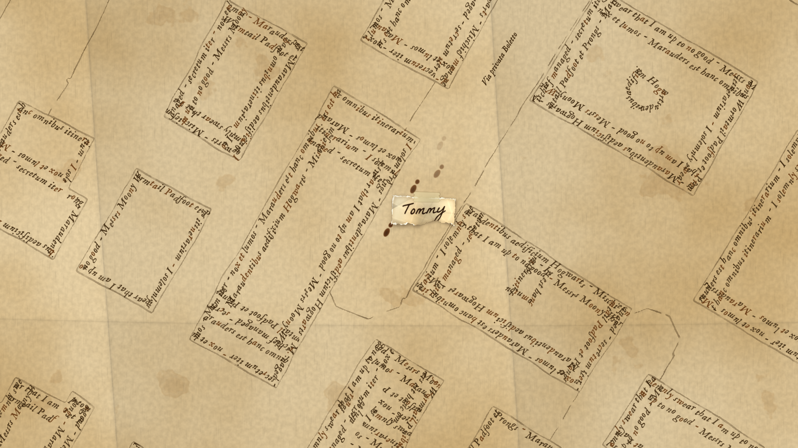

# The Marauder's Map

The real world drawn like the Marauder's Map from Harry Potter, with footsteps of your family
walking around in real time, from Apple Find My.



```bash
pnpm install && pnpm build
node server/cli.ts login     # Apple ID, password and the 2FA code, once every ~2 months
node server/cli.ts --open    # http://localhost:5317
```

Without a login the map shows demo walkers.

## How it works



The CLI logs in to iCloud like icloud.com does, polls Find My and serves the map on localhost.
Nothing leaves your Mac.



Streets, buildings and water from OpenStreetMap become a color mask. A shader redraws it every
frame like a broad nib pen. Up close every wall is written in tiny Latin.



## Commands

| command | what it does |
| --- | --- |
| `marauders-map` | serves the map on localhost and polls Find My every 60 s (`--port`, `--interval`, `--open`) |
| `marauders-map login` | signs in to iCloud with SRP and two factor auth (type `sms` for a text code), saves the session |
| `marauders-map devices` | prints the devices Find My knows about (`--json`) |
| `marauders-map logout` | forgets the session |

Phones and watches show the owner's name ("Tommy's iPhone" becomes "Tommy"). Family Sharing
devices are included. Friends who only share their location in Find My are not available from
iCloud; see `docs/find-my-data.md`.

Live GPS tracks can also be pushed by the OwnTracks or Overland phone apps to
`POST /api/owntracks` and `POST /api/overland`.

## Credits

Map data © [OpenStreetMap](https://www.openstreetmap.org/copyright) contributors, tiles by
[OpenFreeMap](https://openfreemap.org) and [OpenMapTiles](https://www.openmaptiles.org/). The
iCloud login is a TypeScript port of [pyicloud](https://github.com/timlaing/pyicloud). Fonts are
listed in `public/fonts/LICENSES.md`. Not affiliated with Apple or Warner Bros.

Made by Opus 5.5.

## URL params

`?open` skips the cover, `?demo` forces demo walkers, `?lat=&lon=&mpp=` sets the start view, `?layer=mask` shows the class mask.
